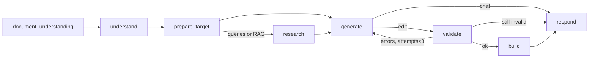

# Architecture

## 1. LangGraph workflow (`backend/app/graph.py`)

| Node | Responsibility |
|---|---|
| `document_understanding` | Runs the deep analyser for the active file (cached in DB) |
| `understand` | LLM call → intent (`chat`/`edit`), target format, web queries, whether to use RAG |
| `prepare_target` | If creating without a template, copies the built-in starter template for the requested format |
| `research` | DuckDuckGo snippets + Pinecone retrieval from the session namespace → numbered sources `S1..Sn` |
| `generate` | LLM returns JSON `{reply, ops[]}` using the compact analysis, op schema and sources |
| `validate` | Checks op names/params and that every paragraph/slide/shape/sheet/table index exists; failures are fed back to `generate` (max 3 attempts) |
| `build` | Applies ops to a *copy* of the file, appends sources if cited, runs the fidelity check |
| `respond` | Final message: reply + change log + format-check result + cited sources |

## 2. Template analysis (`backend/app/analyzers/`)
| Format | Captured |
|---|---|
| DOCX | page size/orientation, margins, header/footer distance, header/footer text and **images**, page-number fields, styles in use (font, size, colour), heading outline, every paragraph (style, alignment, first-run font/size/colour), tables (style, borders, header shading), inline **and anchored** images with size and position, theme colours/fonts |
| PPTX | slide size, masters (shapes such as **logos/bands**, title/body style), layouts + placeholders, every slide's shapes with position/size, fonts, fills, placeholder type, pictures, tables, charts, notes |
| XLSX | per sheet: dimensions, header row, column widths, row heights, merged cells, freeze panes, per-column header/sample style (font, fill, borders, number format, alignment), formulas, conditional formatting, data validation, images with anchors, charts, tables, auto-filter, page setup, header/footer, tab colour |

Output is full JSON (shown in the UI) plus a compact projection fed to the LLM.

## 3. Why formatting is preserved
The LLM never writes a file. It emits **operations** (`replace_text`, `append_paragraph`, `add_slide`, `append_row` …) against indices in the analysis.
The editors open the *original* file and modify it in place:
- text replacement works at run level, so the first run's font/colour/size survive;
- new paragraphs / table rows / slides are **clones** of existing ones (`like_index`, last table row, a slide layout or duplicated slide) so style, numbering and bullets carry over;
- slides come from the deck's own layouts → master logos, bands, fonts and theme apply automatically;
- new spreadsheet rows copy the style of the previous data row (fill, borders, number formats); widths, freeze panes, validations, conditional formats are untouched.

`editors/fidelity.py` then re-analyses the result and compares invariants (page setup, margins, headers/footers/logos, tables' style/borders, theme, masters/layouts, new fonts, column widths, freeze panes, images). Differences are reported to the user.

## 4. RAG & citations
- Every uploaded file and every generated version is chunked (~900 chars) and embedded (fastembed `bge-small-en-v1.5`, 384-d) into the Pinecone namespace `session_id`.
- Retrieval hits and web results become numbered sources. The model must cite as `[S#]`; only sources actually cited are kept, stored with the message, shown as chips in the UI and appended to the document (Sources section / slide / sheet).

## 5. Data model (PostgreSQL)
`chat_sessions` 1─* `messages` (role, content, sources JSON, artifact_id) · `chat_sessions` 1─* `artifacts` (name, kind, role = template|reference|output, version, parent_id, path, analysis JSON, change_log JSON).

## 6. Scalability & deployment notes
- Stateless API → run N replicas behind a load balancer; move `STORAGE_DIR` to S3/GCS (the only local state) and run graph turns on a task queue (Celery/RQ) for long jobs.
- Pinecone namespaces isolate sessions; Postgres via pooled connections (`pool_pre_ping`).
- LLM calls retry with exponential back-off on 429s; provider is a one-line config switch.
- Containerised (`Dockerfile`); add auth (OAuth/JWT), rate limiting and malware scanning of uploads before production use.
